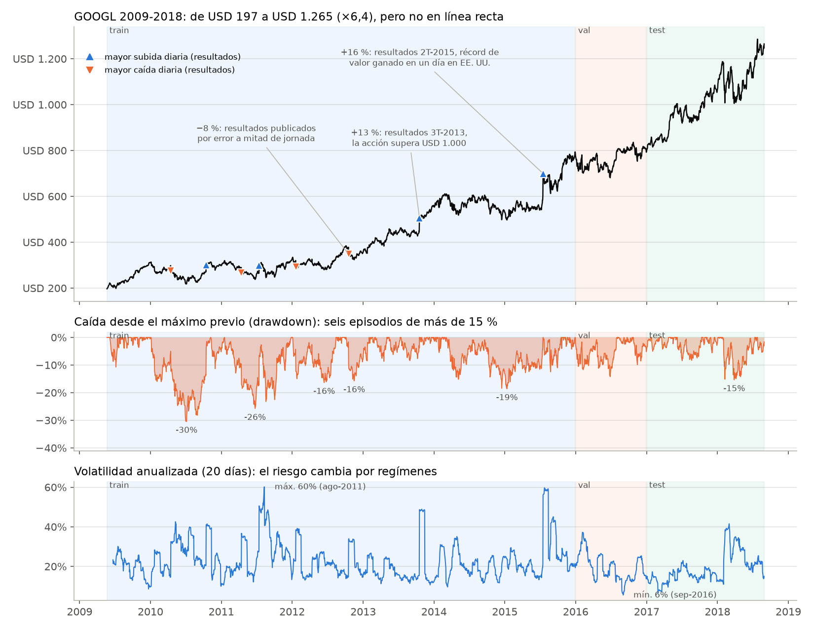
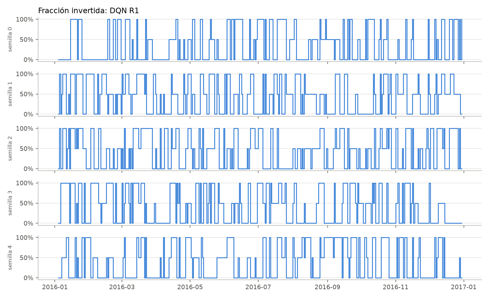
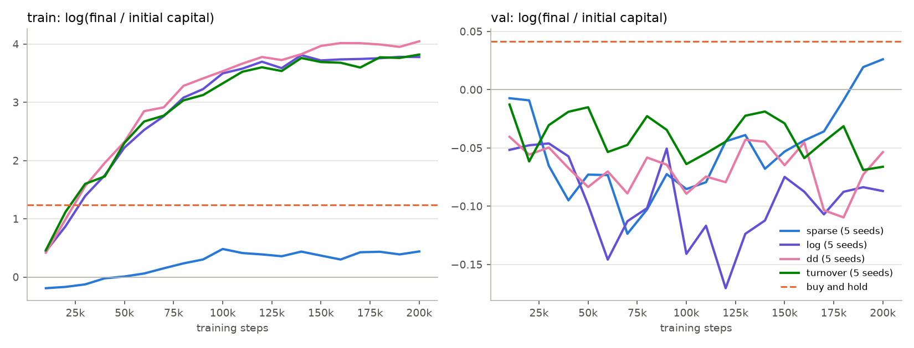
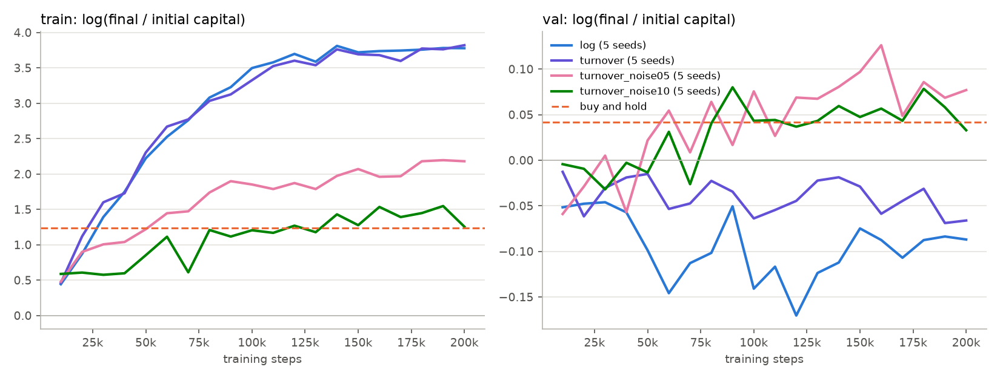
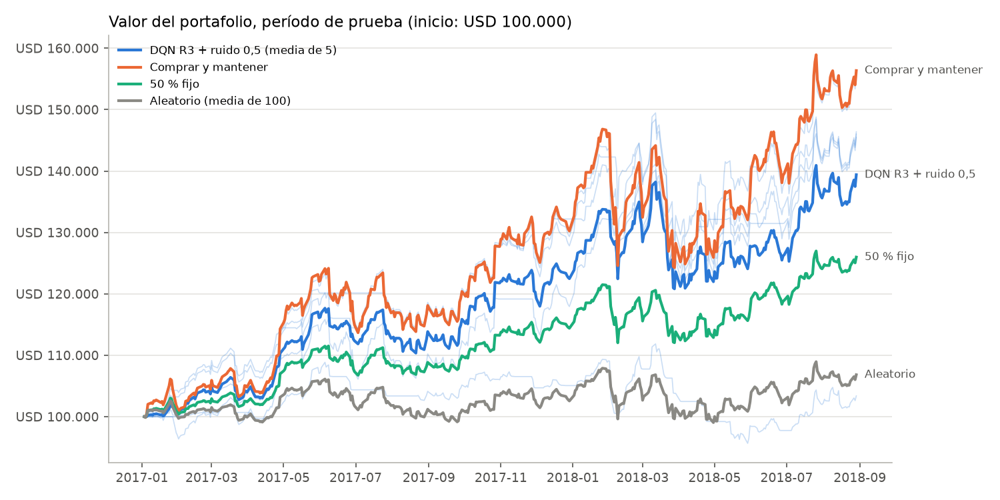
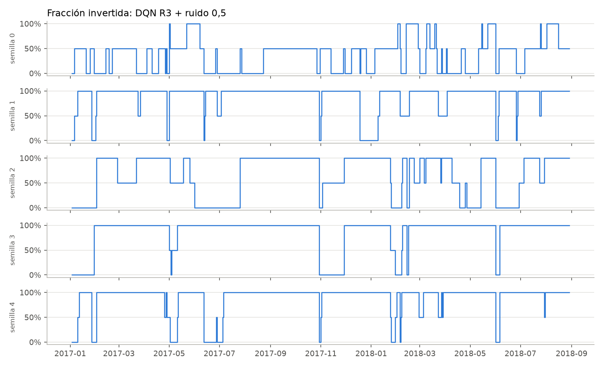

# Informe — Proyecto final «Agente Inversor»

*Simulación y Aprendizaje por Refuerzo · Universidad de La Sabana · 2026-2*

## Contenido

- [Resumen](#resumen)
- [a. Formulación del problema](#a-formulación-del-problema)
- [b. Diseño del entorno y de la función de recompensa](#b-diseño-del-entorno-y-de-la-función-de-recompensa)
- [c. Protocolo de evaluación](#c-protocolo-de-evaluación)
- [d. Comparación contra baselines](#d-comparación-contra-baselines)
- [e. Discusión y reflexión](#e-discusión-y-reflexión)
- [Reproducibilidad](#reproducibilidad)
- [Referencias](#referencias)

---

## Resumen

**Pregunta:** ¿puede un agente de aprendizaje por refuerzo aprender una estrategia de inversión que
funcione mejor que estrategias simples cuando se enfrenta a datos que no vio en el entrenamiento?

**Qué hicimos:** planteamos la inversión diaria en una acción (GOOGL, 2009-2018) como un problema
de decisión con tres acciones: invertir 0 %, 50 % o 100 % del capital, pagando un costo de 10 bps
(0,10 %) cada vez que se opera. Construimos un entorno en Gymnasium que no usa información del
futuro (lo comprobamos con pruebas automáticas). Entrenamos agentes DQN con cuatro funciones de
recompensa, cinco semillas cada una, y los comparamos con tres estrategias de referencia: comprar y
mantener, mantener siempre el 50 % invertido y un agente aleatorio.

**Qué encontramos:**

- Las primeras versiones del agente **se aprendieron de memoria** el período de entrenamiento: allí
  multiplicaban el capital por 43, pero perdían dinero con datos nuevos. Además **operaban
  demasiado**.
- Penalizar las operaciones y, sobre todo, **agregar ruido a lo que ve el agente durante el
  entrenamiento** redujeron esa memorización. En validación el agente quedó a la par de comprar y
  mantener (+5,3 % frente a +4,2 %), con caídas menores y entre 5 y 18 veces menos operaciones.
- **En el período de prueba (2017-2018), que evaluamos una sola vez, el agente no le gana a comprar
  y mantener:** obtiene +39,4 % (promedio de 5 semillas) frente a +56,4 %. Su caída máxima es algo
  menor (−13,9 % frente a −15,4 %), pero su Sharpe también es menor (1,23 frente a 1,45). Sí le gana
  al agente aleatorio (+6,8 %) y a la posición fija de 50 % (+26,0 %).

**Respuesta a la pregunta:** no. Usando solo información del precio, el agente aprende una
estrategia razonable (casi siempre está invertido y en algunos momentos reduce la posición), pero
no logra superar a la estrategia más simple con datos nuevos. La ventaja que mostraba en validación
era más pequeña que la variación entre semillas, y no se mantuvo en la prueba.

---

## a. Formulación del problema

### a.1 El activo y por qué el problema es difícil



*Figura 1. Precio de cierre (arriba), caída desde el máximo previo (centro) y volatilidad anualizada
de 20 días (abajo). Las bandas marcan los períodos de entrenamiento, validación y prueba; los
triángulos, los 8 mayores movimientos diarios. Fuente: `notebooks/eda.ipynb`.*

Entre 2009 y 2018 el precio de GOOGL pasó de USD 197 a USD 1.265, es decir, se multiplicó por 6,4.
Parece fácil ganar dinero así, pero la Figura 1 muestra que el camino no fue recto. La siguiente
tabla resume qué hace difícil decidir **cuándo** estar invertido:

| Característica | Lo que muestran los datos | Qué significa para el agente |
|---|---|---|
| **Tendencia alcista fuerte** | El precio se multiplicó por 6,4; solo en entrenamiento subió 295 % | Comprar y mantener es un rival difícil: cada día fuera del mercado puede costar parte de la subida |
| **Caídas fuertes pero temporales** | 6 caídas de más de 15 %, la peor de −30 % (2010); cada una duró entre 4 y 17 meses desde el máximo hasta recuperarse | Salir en una caída solo sirve si se vuelve a entrar a tiempo, y cada salida y entrada cuesta |
| **El riesgo cambia por épocas** | La volatilidad anual va de 6 % (sep-2016) a 60 % (ago-2011) | El riesgo de estar invertido no es siempre el mismo, así que el agente necesita una medida de volatilidad |
| **El mercado cambia con el tiempo** | 2016 fue mucho más tranquilo que 2009-2015; la curtosis es 13,3 en entrenamiento y 2,5 en validación | Lo que el agente aprende en una época puede no servir en la siguiente (no estacionariedad) |
| **Saltos por noticias** | Los 8 mayores movimientos diarios (entre −8 % y +16 %) fueron días de resultados trimestrales | Los eventos que más pesan no aparecen en los indicadores de precio que ve el agente |
| **Poca señal y mucho ruido** | El retorno diario promedio es 0,08 % y la desviación 1,57 %; ningún indicador tiene una correlación mayor a 0,03 con el retorno del día siguiente | Hay muy poca información útil, y es fácil que el agente aprenda patrones que no existen |

Tres de esos saltos muestran bien el último punto:

- **17-jul-2015 (+16 %).** Los resultados del segundo trimestre produjeron la mayor ganancia de
  valor de mercado en un solo día en la historia de EE. UU. hasta ese momento
  ([AP vía KTVU](https://www.ktvu.com/news/google-shares-gain-a-record-65b-in-value)).
- **18-oct-2013 (+13 %).** Después de los resultados del tercer trimestre, la acción superó por
  primera vez los USD 1.000
  ([NPR vía WSIU](https://www.wsiu.org/economy/2013-10-18/google-shares-top-1-000-for-first-time)).
- **18-oct-2012 (−8 %).** El informe de resultados se publicó **por error** a mitad de la jornada y
  la negociación de la acción se suspendió
  ([TechCrunch](https://techcrunch.com/2012/10/18/googles-stock-takes-a-dive-after-mid-day-earnings-release-trading-halted/)).

Como nuestro agente solo ve indicadores calculados con el precio, no tiene forma de anticipar estos
saltos. Por eso no esperamos que adivine si el precio va a subir o bajar. Lo que sí puede aprender
es **cuánto conviene tener invertido** en cada momento según el riesgo.

### a.2 Por qué aprendizaje por refuerzo

Invertir es una secuencia de decisiones: se mira el mercado, se decide una posición, el precio
cambia, se gana o se pierde, y se vuelve a decidir. Las decisiones están conectadas entre sí, porque
lo que cuesta cambiar de posición depende de la posición que se tenía antes. Además, el objetivo
(el dinero al final) se acumula con el tiempo. Un modelo supervisado intentaría predecir el precio;
un agente de RL, en cambio, aprende directamente **qué hacer** para que el dinero al final sea el
mayor posible.

La literatura también reporta las dificultades que vimos en nuestros datos: poca señal frente al
ruido y riesgo de sobreajustar el backtest
([Liu et al., 2022](https://proceedings.neurips.cc/paper_files/paper/2022/hash/0bf54b80686d2c4dc0808c2e98d430f7-Abstract.html);
[Bailey et al., 2017](https://www.risk.net/journal-of-computational-finance/2471206/the-probability-of-backtest-overfitting)),
mercados que cambian con el tiempo, información incompleta y costos simplificados
([Pippas, Ludvig y Turkay, 2025](https://arxiv.org/html/2408.10932v3)).

### a.3 Estado del arte

Nos apoyamos en dos revisiones del tema. Hambly, Xu y Yang (2023) resumen cómo se ha usado RL en
finanzas: ejecución de órdenes, portafolios, opciones, creación de mercado y asesoría automática.
Pippas, Ludvig y Turkay (2025) revisan 167 publicaciones y encuentran que **DQN y Q-learning son los
algoritmos más usados**, que **agregar más variables al estado no siempre mejora los resultados** y
que los modelos se deben validar con cuidado para no sobreajustar.

| Línea | Trabajo | Idea principal | Relación con nuestro proyecto |
|---|---|---|---|
| RL directo | Moody y Saffell (1998, 2001) | Optimizan la política directamente con el **ratio de Sharpe diferencial** e incluyen los costos; S&P 500 mensual 1970-1994 | Antecedente de usar una recompensa que considera el riesgo (nuestra R2) y de incluir costos en la recompensa |
| | Deng et al. (2017) | Una red recurrente aprende a representar las señales del mercado y un módulo de RL decide | Aprenden el estado en vez de diseñarlo a mano, como hicimos nosotros |
| Basado en valor | Théate y Ernst (2021), TDQN | DQN para decidir la posición en un solo activo, maximizando el Sharpe; generan trayectorias artificiales porque hay pocos datos | **El trabajo más parecido al nuestro**; la falta de datos que ellos atacan es justo lo que nos causó sobreajuste |
| | Zhang, Zohren y Roberts (2020) | DQN, *policy gradient* y A2C en 50 contratos de futuros (2011-2019), ajustando por volatilidad; superan a estrategias de momentum a pesar de costos altos | Muestra que vale la pena incluir la volatilidad en la recompensa |
| Portafolios | Jiang, Xu y Liang (2017) | La recompensa es el promedio de retornos logarítmicos; criptomonedas cada 30 minutos | Usan la misma recompensa logarítmica que nuestra R1 |
| | Yang et al. (2020) | Combinan PPO, A2C y DDPG en las 30 acciones del Dow Jones | Combinar agentes ayuda a reducir la variación entre semillas |
| Ejecución | Nevmyvaka, Feng y Kearns (2006) | Q-learning para ejecutar órdenes usando datos del libro de órdenes | Usan RL para decidir *cómo* operar, no *si* invertir |

También existen librerías y plataformas para comparar agentes de trading, como FinRL (NeurIPS 2020
workshop), FinRL-Meta (NeurIPS 2022) y TradeMaster (NeurIPS 2023). Una línea más reciente usa
modelos de lenguaje que leen noticias y gráficos, como FinAgent (KDD 2024). No es RL en sentido
estricto, pero ataca justo lo que muestra la Figura 1: los movimientos más grandes vienen de
noticias.

Nuestro proyecto **no busca competir** con estos trabajos. Usamos el algoritmo más común (DQN), un
solo activo y un estado diseñado a mano. Nos enfocamos en comparar recompensas y en evaluar con
cuidado.

### a.4 El proceso de decisión

| Elemento | Definición |
|---|---|
| Paso | Un día de mercado; la decisión se toma al cierre |
| Estado $s_t$ | 8 indicadores del precio hasta el día t + la fracción invertida actual (9 valores) |
| Acción $a_t$ | Qué fracción del capital tener invertida: 0 %, 50 % o 100 % |
| Transición | Se ajusta la posición al cierre de t, pagando 10 bps sobre lo que se opera; luego el precio pasa de $P_t$ a $P_{t+1}$ |
| Recompensa $r_{t+1}$ | Cuatro versiones, ver [b.4](#b4-diseño-e-iteración-de-la-recompensa) |
| Episodio | Entrenamiento: una ventana aleatoria de 252 días. Evaluación: el período completo |
| Descuento | $\gamma = 0{,}99$ (el agente mira unos 100 días hacia adelante) |

### a.5 Estado: qué observa el agente

**¿Qué observa exactamente?** Un vector de 9 números: 8 indicadores normalizados y la fracción que
tiene invertida en ese momento.

| Indicador | Definición | Por qué puede servir |
|---|---|---|
| `ret_1` | $\ln(P_t/P_{t-1})$ | Lo que pasó ayer |
| `ret_5` | $\ln(P_t/P_{t-5})$ | Tendencia de la última semana |
| `ret_20` | $\ln(P_t/P_{t-20})$ | Tendencia del último mes |
| `gap_sma20` | $P_t / \text{media}_{20} - 1$ | Qué tan lejos está el precio de su promedio reciente |
| `trend_20_50` | $\text{media}_{20} / \text{media}_{50} - 1$ | Si la tendencia de corto plazo va por encima o por debajo de la de mediano plazo |
| `vol_20` | Desviación de `ret_1` en 20 días | Qué tan riesgoso está el mercado (Figura 1, abajo) |
| `rsi_14` | RSI de Wilder de 14 días, escalado a [−0,5; 0,5] | Si el precio ha subido o bajado "demasiado" seguido |
| `volume_z` | $\ln(\text{Vol}_t / \text{media}_{20}(\text{Vol}))$ | Días con actividad inusual; tiene una correlación de 0,52 con el tamaño del movimiento diario |
| posición | Fracción invertida antes de decidir | Sin ella el agente no sabría si cambiar de posición le cuesta comisión |

**¿Qué período histórico usa?** Ventanas de 1, 5, 14, 20 y 50 días que terminan en el día t. Los
primeros 50 días del dataset se descartan porque no tienen suficiente historia.

**¿Por qué estos indicadores?** Cubren lo que vimos en la Figura 1: tendencia (`ret_*`,
`gap_sma20`, `trend_20_50`), riesgo (`vol_20`) y actividad (`volume_z`). Usamos retornos y razones
en vez de precios porque el precio cambia muchísimo en el período (de 197 a 1.265). El análisis
exploratorio mostró dos limitaciones que aceptamos: los indicadores de tendencia se parecen mucho
entre sí, y ninguno predice por sí solo el retorno del día siguiente (|IC| < 0,03).

**¿Cómo evitamos usar información del futuro?**

1. Todos los indicadores miran solo hacia atrás.
2. La normalización (z-score) usa la media y la desviación **solo del período de entrenamiento**.
3. El agente decide con el precio de cierre del día t, y el resultado de esa decisión es lo que
   pasa entre t y t+1.
4. Lo comprobamos con pruebas automáticas: si se cambian los precios futuros, los indicadores del
   pasado y la normalización no cambian (`tests/test_invest_env.py`).

### a.6 Acciones

**¿Qué acciones puede tomar?** Tres: dejar invertido el 0 %, el 50 % o el 100 % del capital.

**¿Qué significa cada una?** 0 %: todo en efectivo, sin riesgo de mercado. 50 %: la mitad del
riesgo y de la posible ganancia. 100 %: todo invertido, igual que comprar y mantener mientras dure.
La acción indica la fracción que se quiere tener; si el precio cambia esa fracción, el entorno la
reajusta y cobra el costo del ajuste.

**¿Por qué estas tres?** Es lo que recomienda el enunciado, es fácil de interpretar y funciona con
DQN, que necesita acciones discretas. La opción de 50 % permite bajar el riesgo sin salir del todo,
algo que el entorno base `stocks-v0` (solo comprar o vender todo) no permite.

**¿Qué no puede hacer el agente?** Apostar a la baja (ir en corto), invertir más del 100 %
(apalancamiento), elegir porcentajes distintos de 0, 50 y 100, ni decidir en qué momento del día
ejecutar.

---

## b. Diseño del entorno y de la función de recompensa

### b.1 Datos

Usamos `STOCKS_GOOGL`, que viene incluido en `gym-anytrading`: precios diarios (apertura, máximo,
mínimo, cierre y volumen) de GOOGL entre el 22-may-2009 y el 29-ago-2018, en total 2.335 días. Los
dividimos por fechas en tres períodos:

| Período | Fechas | Días con indicadores | Uso |
|---|---|---|---|
| Entrenamiento | 2009-05 → 2015-12 | 1.616 | El agente aprende |
| Validación | 2016 | 252 | Elegir recompensa e hiperparámetros |
| Prueba (*held-out*) | 2017-01 → 2018-08 | 418 | Evaluación final, una sola vez |

### b.2 Por qué hicimos un entorno propio

El repositorio base del curso trae `stocks-v0`, de `gym-anytrading`. Al revisar su código vimos que
no se ajustaba a este proyecto:

- solo tiene dos acciones (comprar todo o vender todo);
- el agente ve los precios sin normalizar;
- la recompensa es en dólares, solo se recibe al vender y **no incluye los costos**;
- los costos (1,5 % ida y vuelta) solo afectan una métrica de reporte;
- no separa los datos por períodos;
- el valor del portafolio solo se actualiza cuando se opera.

Por eso construimos `InvestEnv` con el mismo dataset y la misma interfaz de Gymnasium. La recompensa
de `stocks-v0` la reprodujimos como una de nuestras versiones (R0), para medir su efecto.

### b.3 El entorno

En cada paso pasa lo siguiente:

1. El agente ve los indicadores del día t y su posición actual.
2. Elige qué fracción quiere tener invertida.
3. El portafolio se ajusta al precio de cierre de t y paga 10 bps sobre el monto operado.
4. El precio pasa del cierre de t al de t+1, y el portafolio sube o baja con él.
5. Se calcula la recompensa.

El entorno lleva la cuenta del valor del portafolio día a día, de la fracción invertida (que también
cambia cuando se mueve el precio) y de los costos pagados. **Supuesto:** se puede operar al mismo
precio de cierre que el agente acaba de ver. Una opción más conservadora sería operar a la apertura
del día siguiente.

Ocho pruebas automáticas revisan el entorno: que los indicadores y la normalización no usen datos
del futuro; que los períodos no se crucen; que invertir 100 % todo el tiempo dé lo mismo que comprar
y mantener menos un solo costo; que 0 % todo el tiempo no cambie el capital; que la suma de las
recompensas logarítmicas sea igual al logaritmo de lo que creció el capital; que la decisión del día
t gane exactamente el movimiento de t a t+1; y que la penalización de R3 solo se cobre al operar.

### b.4 Diseño e iteración de la recompensa

| Id | Recompensa | Por qué la probamos |
|---|---|---|
| R0 `sparse` | Ganancia en dólares de lo que se vende, solo al vender y sin costos (como `stocks-v0`) | Punto de partida: es la recompensa del entorno base |
| R1 `log` | $\ln(V_{t+1}/V_t)$, con costos | Sumada en un episodio da el logaritmo de lo que creció el capital, así que maximizarla es maximizar el dinero final, ya descontando costos |
| R2 `dd` | R1 − λ · max(0, aumento de la caída), λ = 1 | Además castiga las caídas: perder cuando ya se viene cayendo cuenta doble |
| R3 `turnover` | R1 − κ · \|Δposición\|, κ = 0,005 | Para frenar el exceso de operaciones: cambiar de posición tiene que prometer más de lo que cuesta |

**Algoritmo.** Usamos DQN de Stable-Baselines3, con los mismos hiperparámetros para todas las
recompensas:

| Hiperparámetro | Valor |
|---|---|
| Red | MLP 9 → 64 → 64 → 3, ReLU |
| Tasa de aprendizaje | 1e-4 |
| Tamaño del lote | 64 |
| Replay buffer | 100.000 transiciones |
| Inicio del aprendizaje | 5.000 pasos |
| γ | 0,99 |
| Actualización de la red | cada 4 pasos |
| Red objetivo | se actualiza cada 1.000 pasos |
| Exploración ε-greedy | de 1,0 a 0,02 en los primeros 60.000 pasos |
| Pasos de entrenamiento | 200.000 |
| Criterio de parada | número fijo de pasos (ver iteración 2) |
| Semillas | 0, 1, 2, 3, 4 |

**Iteración 1: R0, R1 y R2.** Resultados en validación (2016), promedio de 5 semillas:

| Estrategia | Retorno | Máx. drawdown | Costos | Operaciones | Exposición |
|---|---|---|---|---|---|
| R0 `sparse` | +2,9 % | −11,6 % | USD 6.775 | 92 | 73 % |
| R1 `log` | −8,4 % | −14,1 % | USD 8.588 | 125 | 40 % |
| R2 `dd` | −5,3 % | −10,6 % | USD 7.170 | 94 | 28 % |
| Comprar y mantener | +4,2 % | −13,5 % | USD 100 | 1 | 100 % |

Ningún agente le ganó a comprar y mantener, y todos **operaban demasiado**: entre 92 y 125 cambios
de posición en 252 días, gastando entre 6 y 9 % del capital en costos. La Figura 2 lo muestra para
R1: el agente cambia de posición casi todos los días.



*Figura 2. Fracción invertida por R1 en 2016, una fila por semilla.*

Para entender por qué, probamos dos hipótesis:

- **Hipótesis 1 (descartada): el agente está indeciso.** Si los valores Q de las tres acciones
  fueran casi iguales, el agente cambiaría de acción por cualquier ruido. Medimos la diferencia
  entre la mejor y la segunda acción: la mediana es 0,0065 para R1, **6,5 veces** el costo de un
  cambio completo. O sea, el agente no está indeciso: está "seguro" de que le conviene operar.
- **Hipótesis 2 (confirmada): el agente memorizó el entrenamiento.** En el período de
  entrenamiento, R1 multiplica el capital por 43 (Sharpe 3,5, caída máxima −7,7 %) y R2 por 59
  (Sharpe 3,9, −4,9 %), cuando comprar y mantener lo multiplica por 3,4. Con 200.000 pasos sobre
  1.616 días, el agente ve cada día unas 125 veces y termina aprendiéndose qué hacer en cada uno.
  Eso no le sirve para 2016.

**Iteración 2: R3 y curvas de aprendizaje.** Cambiamos la recompensa (R3) para castigar el exceso de
operaciones. También medimos cada 10.000 pasos cómo le iba al agente en todo el período de
entrenamiento y en validación, para ver en qué momento empieza a memorizar (Figura 3).



*Figura 3. Logaritmo del crecimiento del capital (0 = sin ganancia) frente a los pasos de
entrenamiento, promedio de 5 semillas. Línea punteada: comprar y mantener.*

| Estrategia (200k pasos) | Retorno val | Máx. drawdown | Costos | Operaciones |
|---|---|---|---|---|
| R1 `log` | −8,4 % | −14,1 % | USD 8.588 | 125 |
| R3 `turnover` | −6,8 % | −12,4 % | USD 5.895 | 92 |

Lo que observamos:

- R3 gasta un 31 % menos en costos que R1 y le va mejor que a R1 en validación en casi todos los
  puntos de la curva. La penalización ayuda, pero no es suficiente.
- La memorización empieza muy pronto: con apenas 20.000 a 30.000 pasos, R1, R2 y R3 ya le ganan a
  comprar y mantener **en entrenamiento**, y siguen subiendo hasta multiplicar el capital por 43 a
  55.
- En validación ningún punto de la curva es claramente mejor que los demás: las diferencias son del
  mismo tamaño que la variación entre semillas. Parar el entrenamiento antes no resuelve el
  problema.
- R0 aprende lento y casi no memoriza (×1,5 en entrenamiento); termina "invertido casi todo el
  tiempo".
- Al repetir las 15 corridas de R0, R1 y R2 con las mismas semillas obtuvimos exactamente los
  mismos resultados de la iteración 1, así que el experimento es reproducible.

**Iteración 3: R3 con ruido en lo que ve el agente.** Como parar antes no funcionó, agregamos ruido
gaussiano a los 8 indicadores, **solo durante el entrenamiento**. Así el agente nunca ve el mismo
día exactamente igual dos veces y le cuesta más memorizarlo. La posición, los precios y los
entornos de evaluación no llevan ruido. Probamos dos niveles de ruido (σ = 0,5 y σ = 1,0, en
desviaciones estándar) sobre R3, con los mismos hiperparámetros.



*Figura 4. Igual que la Figura 3, comparando R1 y R3 con las dos versiones con ruido.*

| Variante | Capital en entrenamiento (5 semillas) | Retorno val | Máx. drawdown | Costos | Operaciones | Log-crecimiento val (media ± desv.) |
|---|---|---|---|---|---|---|
| R3 sin ruido | ×22 a ×65 | −6,8 % | −12,4 % | USD 5.895 | 92 | −0,073 ± 0,070 |
| R3 + ruido 0,5 | ×7,3 a ×9,5 | +5,3 % | −9,8 % | USD 1.246 | 20 | **0,051 ± 0,057** |
| R3 + ruido 1,0 | ×1,7 a ×5,1 | +5,0 % | −10,5 % | USD 385 | 7 | 0,046 ± 0,073 |
| Comprar y mantener | ×3,4 | +4,2 % | −13,5 % | USD 100 | 1 | 0,042 |

- El ruido reduce mucho la memorización. Con σ = 1,0, el agente en entrenamiento queda más o menos
  igual que comprar y mantener, y la diferencia entre entrenamiento y validación casi desaparece.
- Por primera vez los agentes igualan o superan a comprar y mantener en validación, con caídas
  menores y entre 5 y 18 veces menos operaciones que en la iteración 2.
- Pero la ventaja (cerca de 1 punto) es mucho más pequeña que la variación entre semillas (±6-7
  puntos). Por eso decimos que el resultado es **comparable, no mejor**. Además, al elegir el mejor
  de 6 configuraciones en validación, su resultado allí sale un poco inflado (sesgo de selección).

**Agente final.** Aplicamos la regla que habíamos fijado antes (el mayor log-crecimiento promedio en
validación) y el agente final es **R3 + ruido σ = 0,5**. La diferencia con σ = 1,0 es muy pequeña,
pero preferimos respetar la regla escrita y no cambiar la elección después de ver los resultados.

---

## c. Protocolo de evaluación

1. **Separación por fechas.** Entrenamiento (2009-2015), validación (2016) y prueba (2017-2018), sin
   días repetidos entre ellos.
2. **Todas las decisiones se toman con validación:** qué recompensa usar, qué hiperparámetros y
   cuántos pasos entrenar. El período de prueba no se usa para nada de esto.
3. **Regla de selección fijada antes de ver la prueba:** se elige la configuración con el mayor
   logaritmo del crecimiento promedio del capital en validación (5 semillas). Si hay empate, la que
   opere menos.
4. **Evaluación final una sola vez.** El agente elegido se congela y se evalúa en la prueba con
   `rlgames-sb backtest --split test --final`. Sin esa opción, el comando no deja correr sobre la
   prueba. La evaluación se hizo una única vez, el 20-oct-2026, después de elegir el agente final
   (el resultado está en `results/test_final.log`).
5. **Mismas condiciones para todos:** mismos días, costo de 10 bps y capital inicial de
   USD 100.000. Los agentes deciden sin exploración (*greedy*).
6. **Cinco semillas por configuración**, reportando promedio y variación; el agente aleatorio se
   promedia sobre 100 corridas.
7. **Métricas:** retorno acumulado, caída máxima, costos pagados, número de operaciones, exposición
   promedio, volatilidad anualizada y ratio de Sharpe.

---

## d. Comparación contra baselines

**Baselines:** comprar y mantener (100 % invertido desde el primer día), posición fija de 50 % y
agente aleatorio (100 corridas).

**Validación (2016)**, promedio de semillas:

| Estrategia | Retorno | Máx. drawdown | Costos | Operaciones | Exposición | Sharpe |
|---|---|---|---|---|---|---|
| R0 `sparse` | +2,9 % | −11,6 % | USD 6.775 | 92 | 73 % | 0,26 |
| R1 `log` | −8,4 % | −14,1 % | USD 8.588 | 125 | 40 % | −0,66 |
| R2 `dd` | −5,3 % | −10,6 % | USD 7.170 | 94 | 28 % | −0,51 |
| R3 `turnover` | −6,8 % | −12,4 % | USD 5.895 | 92 | 38 % | −0,55 |
| R3 + ruido 0,5 (**final**) | +5,3 % | −9,8 % | USD 1.246 | 20 | 71 % | 0,36 |
| R3 + ruido 1,0 | +5,0 % | −10,5 % | USD 385 | 7 | 62 % | 0,53 |
| Comprar y mantener | +4,2 % | −13,5 % | USD 100 | 1 | 100 % | 0,31 |
| 50 % fijo | +2,6 % | −6,9 % | USD 106 | 1 | 50 % | 0,30 |
| Aleatorio (100) | −8,6 % | −14,5 % | USD 10.646 | 168 | 50 % | −0,64 |

**Prueba (2017-01 → 2018-08, 418 días), evaluada una sola vez:**

| Estrategia | Retorno acumulado | Máx. drawdown | Costos | Operaciones | Exposición | Sharpe |
|---|---|---|---|---|---|---|
| **Agente final** (R3 + ruido 0,5, promedio de 5) | **+39,4 %** | **−13,9 %** | USD 2.511 | 36 | 73 % | 1,23 |
| Comprar y mantener | +56,4 % | −15,4 % | USD 100 | 1 | 100 % | 1,45 |
| 50 % fijo | +26,0 % | −7,8 % | USD 156 | 1 | 50 % | 1,44 |
| Aleatorio (promedio de 100) | +6,8 % | −13,4 % | USD 19.078 | 278 | 50 % | 0,36 |

Por semilla, el agente final obtuvo +3,4 %, +46,4 %, +45,5 %, +46,0 % y +55,7 %. El agente
aleatorio va de −9,9 % a +25,2 % (percentiles 5 y 95).



*Figura 5. Valor del portafolio en el período de prueba. Líneas tenues: cada semilla del agente.*



*Figura 6. Fracción invertida por el agente final, una fila por semilla.*

**Qué nos dicen estos resultados:**

- **El agente no le gana a comprar y mantener.** Queda 17 puntos por debajo y con un Sharpe menor.
  Ninguna de las 5 semillas le gana; la mejor queda a menos de un punto.
- **Se comporta como un "comprar y mantener" con menos dinero invertido.** En promedio está
  invertido el 73 % del tiempo (4 de las 5 semillas, entre 65 % y 90 %), y su curva sigue de cerca
  a la de comprar y mantener, un poco por debajo. En un período que subió tanto, cada día fuera del
  mercado le costó.
- **Reduce un poco el riesgo:** su caída máxima es −13,9 % frente a −15,4 %, pero eso no compensa
  el menor retorno (Sharpe 1,23 frente a 1,45). Curiosamente, la posición fija de 50 % logra casi
  el mismo Sharpe que comprar y mantener con la mitad de la caída. En este período, bajar el riesgo
  de forma constante funcionó mejor que hacerlo de forma activa.
- **Le gana con claridad al agente aleatorio** (+39,4 % frente a +6,8 %) y a la posición de 50 %,
  así que lo que aprendió no es azar. Opera 8 veces menos que el aleatorio y paga 7 veces menos en
  costos.
- **La ventaja de validación no se mantuvo.** En 2016 el agente iba 1,1 puntos por encima de
  comprar y mantener; en la prueba quedó 17 puntos por debajo. Esto es lo que esperábamos que
  podía pasar: esa ventaja era más pequeña que la variación entre semillas, y además venía de elegir
  el mejor de 6 candidatos.

---

## e. Discusión y reflexión

### e.1 Comportamiento inesperado: el agente memoriza el entrenamiento

El hallazgo principal es que los agentes R1, R2 y R3 logran en entrenamiento resultados imposibles
en la vida real (multiplicar el capital por 43 a 59 con caídas de solo 5 a 8 %) y luego pierden con
datos nuevos. Esto es sobreajuste. Como el estado tiene 9 variables continuas, cada día de
entrenamiento es prácticamente único, y la red puede aprenderse qué hacer en cada uno. La señal real
es muy débil (|IC| < 0,03), así que lo que memoriza es ruido. En finanzas esto es peor que en otros
problemas, porque solo existe un histórico y el agente lo recorre muchas veces.

### e.2 Comportamientos raros del agente final en la prueba

- **Una semilla se comporta distinto.** La semilla 0 está invertida solo el 37 % del tiempo y gana
  +3,4 %, mientras que las otras cuatro ganan entre +45 y +56 %. Tiene los mismos datos y la misma
  configuración; lo único que cambia es la inicialización aleatoria, y aun así aprendió una
  estrategia mucho más conservadora. Por eso es importante reportar varias semillas.
- **Varias semillas salen del mercado el mismo día.** Cuatro de cinco salen el 30-oct-2017, el día
  después de un salto de +4,3 % por los resultados del tercer trimestre de 2017, y las cinco salen
  el 1-jun-2018, en un día de +3,2 %. En los dos casos el precio estaba entre 3 y 5 % por encima de
  su promedio de 20 días. Esas salidas no anticiparon caídas: 20 días después el precio estaba
  +2,9 % y −0,5 %, y 40 días después +2,6 % y +8,4 %. Al agrupar todos los días de la prueba según
  el valor de los indicadores, la exposición promedio solo baja un poco en los extremos (de 0,78 a
  0,69-0,72), así que no encontramos una regla clara que lo explique.

### e.3 Reward hacking

En entrenamiento, R2 logra justo lo que su recompensa pide (caídas mínimas), pero lo hace
memorizando en qué días salir, no con una regla que sirva para otros datos. Es decir, maximiza la
recompensa sin aprender el comportamiento que queríamos. En el otro extremo, R0, que en teoría es
la peor recompensa (escasa, en dólares y sin costos), es la que mejor funciona en validación: como
da poca información, el agente tiene menos que memorizar y termina "invertido casi siempre", que en
un mercado alcista se parece a comprar y mantener.

### e.4 El mercado cambia con el tiempo

El período de validación fue más tranquilo que el de entrenamiento (menos volatilidad y menos días
extremos). Un agente que aprendió con 2009-2015 se encuentra en 2016 con situaciones distintas. En
la prueba el mercado vuelve a cambiar: sube mucho (+56 %) y tiene un aumento de volatilidad a
inicios de 2018. El ruido ayudó a reducir la memorización, pero no puede corregir que la relación
entre los indicadores y lo que pasa después cambie de una época a otra (no estacionariedad).

### e.5 Limitaciones

- **Un solo activo y un solo histórico:** no podemos generalizar los resultados a otras acciones ni
  a otros períodos.
- **El agente solo ve el precio:** no tiene en cuenta noticias ni resultados trimestrales, que son
  los que explican los movimientos más grandes.
- **Suponemos que se opera al precio de cierre ya observado,** sin tener en cuenta el diferencial
  entre compra y venta ni el deslizamiento de precios.
- **Validación de un solo año:** 252 días son pocos para distinguir diferencias pequeñas entre
  configuraciones, porque la variación entre semillas es del mismo tamaño. La ventaja del agente
  final en validación no se mantuvo en la prueba.
- **No ajustamos los hiperparámetros de DQN con Optuna;** usamos los mismos para todas las
  recompensas, para que la comparación fuera justa.

### e.6 Reflexión del grupo

*Por indicación del profesor, la reflexión se responde en grupo.*

**1. ¿Cuál fue el resultado que más nos sorprendió?**

Que la mejor estrategia que vimos en todo el proyecto resultara ser falsa. En la primera iteración,
el agente R1 multiplicó el capital por 43 en el período de entrenamiento, con un Sharpe de 3,5 y
caídas de apenas 7,7 %. Si solo hubiéramos mirado el entrenamiento, habríamos creído que teníamos
una estrategia excelente; pero en validación perdía 8,4 %, igual que el agente aleatorio. También
nos sorprendió que R0, la recompensa que en teoría era la peor (escasa, en dólares y sin costos),
funcionara mejor que las que diseñamos con más cuidado: como da menos información, el agente tenía
menos que memorizar.

**2. ¿Qué decisión metodológica tuvo mayor impacto en el agente?**

Agregar ruido a lo que ve el agente durante el entrenamiento (iteración 3). Fue el único cambio que
modificó de verdad su comportamiento: el capital en entrenamiento bajó de ×43-65 a ×7-9 (σ = 0,5) y
a ×2-5 (σ = 1,0), las operaciones en validación bajaron de 92 a 20 y 7 al año, y el retorno en
validación pasó de −6,8 % a +5,3 %. Ni cambiar la recompensa ni parar antes el entrenamiento habían
logrado algo parecido.

Para el resultado del proyecto, sin embargo, lo más importante fue la forma de evaluar: separar
entrenamiento, validación y prueba, fijar la regla de selección antes de ver la prueba y entrenar
cinco semillas. Sin eso habríamos dicho que el agente le ganaba a comprar y mantener (+5,3 % frente
a +4,2 % en validación). La prueba mostró lo contrario (+39,4 % frente a +56,4 %), y nosotros ya
sabíamos que esa ventaja en validación era más pequeña que la variación entre semillas.

**3. ¿Qué cambiaríamos si tuviéramos que repetir el experimento?**

- **Validar en varios períodos y no en uno solo.** Con 252 días, la variación entre semillas (±6-7
  puntos) era mayor que las diferencias entre configuraciones. Validar con varias ventanas de
  tiempo seguidas (*walk-forward*) nos habría dado una señal más confiable para elegir.
- **Comparar menos candidatos, o corregir por haber comparado varios.** Elegir el mejor de seis en
  validación infló su resultado allí, algo sobre lo que advierte la literatura de sobreajuste del
  backtest.
- **Atacar la memorización desde el principio.** Habríamos usado el ruido (u otras formas de
  regularización, como aumentar los datos o combinar semillas) desde la primera iteración, en vez de
  descubrirlo en la tercera.
- **Darle al agente información que no viene del precio.** Los movimientos más grandes de GOOGL
  fueron días de resultados trimestrales, y esas fechas se anuncian con anticipación. Un indicador
  de "faltan N días para resultados" estaría disponible al momento de decidir y podría ayudarle a
  manejar mejor su posición en esos días.
- **Operar de forma más realista,** a la apertura del día siguiente, para no depender del supuesto
  de operar al precio de cierre que ya se vio.

**4. ¿Qué comportamiento del agente no logramos explicar completamente?**

Las salidas al mismo tiempo en el período de prueba. Cuatro de las cinco semillas salieron del
mercado el 30-oct-2017, el día después de un salto de +4,3 % por resultados, y las cinco salieron el
1-jun-2018. Son redes entrenadas por separado y con inicializaciones distintas, y aun así coinciden
en el mismo día, así que parece que reaccionan a algo concreto del estado. Pero al agrupar todos los
días de la prueba según cada indicador, la exposición solo baja un poco en los extremos (de 0,78 a
0,69-0,72), y no encontramos una regla sencilla que lo explique. Tampoco entendemos del todo por qué
la semilla 0, con los mismos datos y la misma configuración, aprendió una estrategia mucho más
conservadora (37 % invertida frente a 65-90 % de las demás).

**5. ¿Cuál fue la principal diferencia entre lo aprendido en Reinforcement Learning y su aplicación
a este problema?**

En los entornos del curso, como Lunar Lander o Breakout, el entorno es un simulador: se puede jugar
todas las veces que se quiera, la recompensa refleja directamente el objetivo y el juego de mañana
funciona igual que el de hoy. Ahí, más recompensa en entrenamiento significa un mejor agente.

En la inversión esto no pasa. Solo tenemos un histórico de precios, y el agente lo recorre tantas
veces que termina aprendiéndoselo de memoria. Además, el mercado cambia con el tiempo, así que lo
que funcionó en 2009-2015 no tiene por qué funcionar después. Y que el agente gane mucho en
entrenamiento no significa que vaya a ganar con datos nuevos. Por eso la mayor parte del trabajo no
fue el algoritmo, que ya venía implementado en Stable-Baselines3, sino construir el entorno, probar
recompensas y evaluar con cuidado. Nos dimos cuenta de que, en un problema real, el algoritmo es
solo una parte del trabajo.

---

## Reproducibilidad

Las instrucciones completas están en el [README](../README.md). En resumen:

```bash
uv sync                                   # dependencias exactas (uv.lock)
uv run pytest                             # 9 pruebas del entorno
bash scripts/train_rewards.sh             # iteraciones 1-2: R0-R3 x 5 semillas
bash scripts/train_rewards.sh turnover_noise05 turnover_noise10   # iteración 3
uv run rlgames-sb curves configs/googl_dqn_{sparse,log,dd,turnover}.yaml          # Figura 3
uv run rlgames-sb curves configs/googl_dqn_{log,turnover,turnover_noise05,turnover_noise10}.yaml \
    --name curves_iter3                                                            # Figura 4
uv run rlgames-sb backtest configs/googl_dqn_turnover_noise05.yaml --split test --final  # Tabla de prueba, Figuras 5-6
uv run python scripts/make_eda_notebook.py          # análisis exploratorio y Figura 1
```

Las semillas 0-4 fijan la red, la exploración y las ventanas de entrenamiento; el agente aleatorio
usa las semillas 0-99. Si se repite el entrenamiento con las mismas semillas, se obtienen
exactamente los mismos resultados. La bitácora de decisiones está en [`decisiones.md`](decisiones.md)
y los experimentos quedan registrados en MLflow.

---

## Referencias

- Bailey, D. H., Borwein, J. M., López de Prado, M. y Zhu, Q. J. (2017). The probability of backtest
  overfitting. *Journal of Computational Finance*, 20(4).
  [risk.net](https://www.risk.net/journal-of-computational-finance/2471206/the-probability-of-backtest-overfitting)
- Deng, Y., Bao, F., Kong, Y., Ren, Z. y Dai, Q. (2017). Deep direct reinforcement learning for
  financial signal representation and trading. *IEEE Transactions on Neural Networks and Learning
  Systems*, 28(3), 653-664.
- Hambly, B., Xu, R. y Yang, H. (2023). Recent advances in reinforcement learning in finance.
  *Mathematical Finance*, 33(3), 437-503. [arXiv 2112.04553](https://arxiv.org/abs/2112.04553)
- Jiang, Z., Xu, D. y Liang, J. (2017). A deep reinforcement learning framework for the financial
  portfolio management problem. [arXiv 1706.10059](https://arxiv.org/abs/1706.10059)
- Liu, X.-Y. et al. (2020). FinRL: A deep reinforcement learning library for automated stock
  trading in quantitative finance. NeurIPS 2020 Deep RL Workshop.
  [arXiv 2011.09607](https://arxiv.org/abs/2011.09607)
- Liu, X.-Y. et al. (2022). FinRL-Meta: Market environments and benchmarks for data-driven
  financial reinforcement learning. *NeurIPS 2022, Datasets and Benchmarks Track*.
  [actas](https://proceedings.neurips.cc/paper_files/paper/2022/hash/0bf54b80686d2c4dc0808c2e98d430f7-Abstract.html)
- Moody, J. y Saffell, M. (1998). Reinforcement learning for trading. *NIPS 1998*.
  [actas](https://papers.nips.cc/paper/1998/hash/4e6cd95227cb0c280e99a195be5f6615-Abstract.html)
- Moody, J. y Saffell, M. (2001). Learning to trade via direct reinforcement. *IEEE Transactions on
  Neural Networks*, 12(4).
- Nevmyvaka, Y., Feng, Y. y Kearns, M. (2006). Reinforcement learning for optimized trade
  execution. *ICML 2006*, 673-680. [PDF](https://www.cis.upenn.edu/~mkearns/papers/rlexec)
- Pippas, N., Ludvig, E. A. y Turkay, C. (2025). The evolution of reinforcement learning in
  quantitative finance: A survey. *ACM Computing Surveys*, 57(11).
  [arXiv 2408.10932](https://arxiv.org/html/2408.10932v3)
- Sun, S., Qin, M. et al. (2023). TradeMaster: A holistic quantitative trading platform empowered
  by reinforcement learning. *NeurIPS 2023, Datasets and Benchmarks Track*.
  [actas](https://proceedings.neurips.cc/paper_files/paper/2023/hash/b8f6f7f2ba4137124ac976286eacb611-Abstract.html)
- Sutton, R. S. y Barto, A. G. (2018). *Reinforcement learning: An introduction* (2.ª ed.). MIT
  Press.
- Théate, T. y Ernst, D. (2021). An application of deep reinforcement learning to algorithmic
  trading. *Expert Systems with Applications*, 173, 114632.
  [arXiv 2004.06627](https://arxiv.org/abs/2004.06627)
- Yang, H., Liu, X.-Y., Zhong, S. y Walid, A. (2020). Deep reinforcement learning for automated
  stock trading: An ensemble strategy. *ICAIF '20*. DOI 10.1145/3383455.3422540.
- Zhang, Z., Zohren, S. y Roberts, S. (2020). Deep reinforcement learning for trading. *The Journal
  of Financial Data Science*, 2(2), 25-40. [arXiv 1911.10107](https://arxiv.org/abs/1911.10107)
- Zhang, W. et al. (2024). A multimodal foundation agent for financial trading: Tool-augmented,
  diversified, and generalist. *KDD 2024*. [arXiv 2402.18485](https://arxiv.org/abs/2402.18485)

Noticias citadas en la sección a.1:
[KTVU/AP (2015)](https://www.ktvu.com/news/google-shares-gain-a-record-65b-in-value) ·
[WSIU/NPR (2013)](https://www.wsiu.org/economy/2013-10-18/google-shares-top-1-000-for-first-time) ·
[TechCrunch (2012)](https://techcrunch.com/2012/10/18/googles-stock-takes-a-dive-after-mid-day-earnings-release-trading-halted/)
